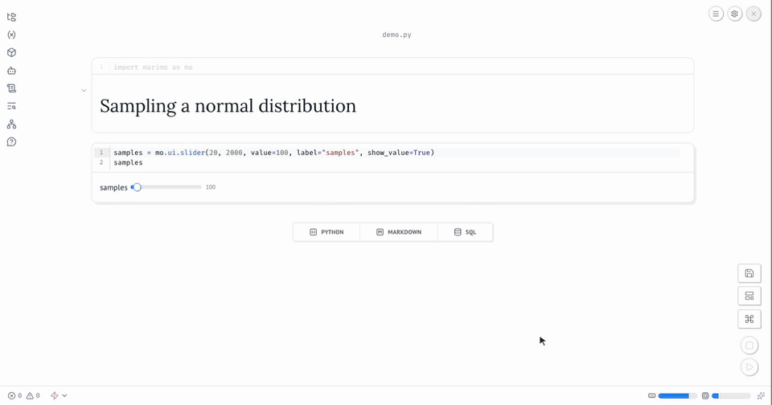
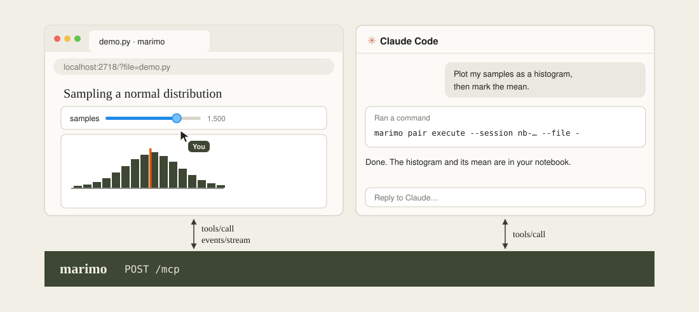

# marimo

A fork of [marimo](https://github.com/marimo-team/marimo) whose editor runs entirely over MCP. Open a notebook, point any agent at it, and work in it together in real time.



The page and agents share one MCP server. The page runs cells, edits code and moves sliders with the same `tools/call` an agent uses, and follows the notebook through [MCP Events](https://github.com/modelcontextprotocol/experimental-ext-triggers-events/blob/main/docs/design-sketch-proposal.md). Agents connect with `marimo pair`, or through the Host Protocol's tools and events.



## Run it

```sh
make py && make fe
marimo edit notebook.py
```

The editor is at `http://localhost:2718/`, its MCP endpoint at `/api/mcp`, and the Host Protocol's at `/api/marimo/v1/mcp`. To pair an agent, ask it to run `marimo pair list` and take it from there.
